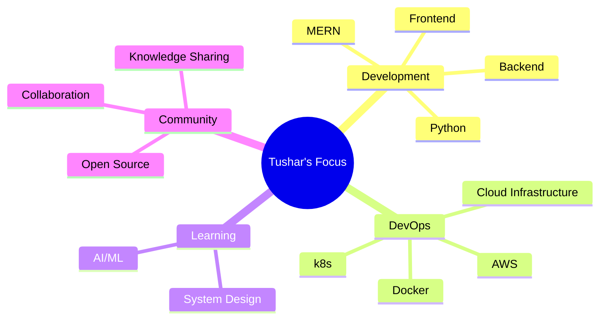

[](https://holopin.io/@tusharprajapat)

<!-- ================= HEADER ================= -->
<div align="center">
  
</div>

<div align="center">

### 🚀 Building Scalable & Automating Systems

[](https://www.linkedin.com/in/tushar-prajapat-256486302/)
[](mailto:tusharprajapat41@gmail.com)

</div>

<br>

<div align="center">
  
</div>

---

## 👨‍💻 About Me

<table>
<tr>
<td width="50%">

```yaml
name: "Tushar Prajapat"
role: "Full Stack Developer & DevOps Enthusiast"
education: "B.Tech CSE (2026)"
location: "Rajasthan, India 🇮🇳"

focus:
  - Full Stack Development (MERN + Python)
  - DevOps
  - AI/ML Learner
  - Scalable System Design

currently_learning:
  - AI/ML (Deep Dive)

motto: "Build → Break → Improve → Repeat"

```
</td>
<td width="50%">


</td>
</tr>
</table>

<br>


## 🛠️ Technology Stack

<details open>
<summary><b>🧠 AI/ML & Deep Learning</b></summary>
<br>


</details>

<details open>
<summary><b>☁️ Cloud & DevOps</b></summary>
<br>


</details>

<details open>
<summary><b>💻 Development & Languages</b></summary>
<br>


</details>


<br>

## 💡 What I'm Up To



<br>

## 📫 Let's Connect

<div align="center">

**💬 Open to exciting AI/ML opportunities and collaborations!**

[](mailto:tusharprajapat41@gmail.com)
[](https://www.linkedin.com/in/tushar-prajapat-256486302/)

</div>

<br>

---

_Thanks for visiting my profile! Let's connect and create something amazing together._


